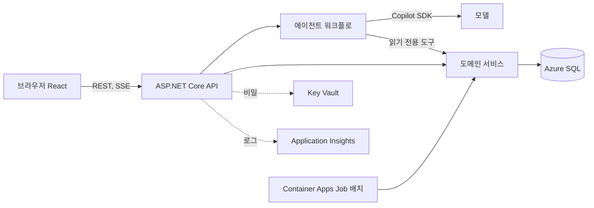
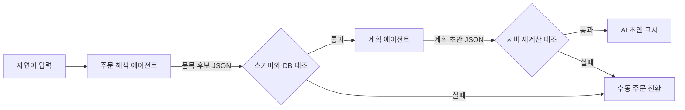
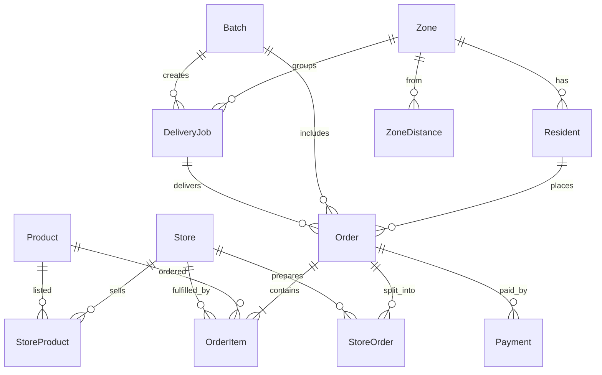

# TRD: 청도 같이장봄

## 1. 문서 관리

| 항목 | 내용 |
| --- | --- |
| 상태 | Implementation-ready (v0.2 승인 2026-11-05) |
| 버전 | 0.2 (기술 스택, 아키텍처, DB 스키마, API 명세 추가) |
| 기준 PRD | PRD.md v0.1 (Implementation-ready, 2026-11-05) |
| 작성 규칙 | 간결한 한국어. ASD-STE100, ISO 24495-1, 국립국어원 규범을 참고한다. 인증을 주장하지 않는다. |
| 표기 | 확정(C), 제안(P), 미정(U) |

## 2. 목적과 범위

- 목적: PRD의 FR-001~016, NFR-001~009를 구현하는 기술 스택과 구조를 정의한다.
- 범위: 웹 화면, API, 에이전트, 배치, 데이터, Azure 배포, 관찰, 보안.
- 제외: 실제 결제, 실제 인증, GPS, 실시간 교통정보 (PRD와 동일).

## 3. 기술 결정 요약

| ID | 결정 | 상태 |
| --- | --- | --- |
| TD-01 | 웹: React + TypeScript. 반응형(360px, 1280px). | C |
| TD-02 | API: ASP.NET Core (.NET). | C |
| TD-03 | 데이터: Azure SQL Database (무료 또는 최소 사양) + EF Core. | C |
| TD-04 | 에이전트: Microsoft Agent Framework 다중 에이전트 워크플로. | C |
| TD-05 | 모델 연결: GitHub Copilot SDK. GitHub 토큰은 Key Vault에 보관한다. 배포 환경 인증 경로는 통합 시험(TR-F-010) 통과 전까지 제안으로 본다. | C (SDK 사용), P (인증 경로) |
| TD-06 | 스트리밍: SSE. | C |
| TD-07 | 배치: Container Apps Jobs. cron은 UTC 기준 `0 0,6 * * *`(KST 09:00, 15:00)이다. 영업일 판정은 앱이 KST로 한다. | C |
| TD-08 | 배포: Azure Service. 개발 실행은 .NET Aspire. | C |
| TD-09 | IaC와 CI/CD: azd(Bicep) + GitHub Actions. Azure 로그인은 OIDC. | C |
| TD-10 | 비밀: Key Vault + Managed Identity. 코드에 비밀을 두지 않는다. | C |
| TD-11 | 관찰: OpenTelemetry + Application Insights. | C (사용자가 서비스 구성으로 확정) |
| TD-12 | DB 등급: 무료 등급을 우선 쓴다. 한도 소진 시 최소 사양 유료 등급으로 전환한다. 구독 자격은 구현 전에 확인한다. | P |

## 4. 아키텍처



### 4.1 구성 요소

| 구성 요소 | 책임 |
| --- | --- |
| Web | 주문, 계획 확인, 상점, 배송자, 데모 화면. 에이전트 진행 상황을 표시한다. |
| API | 요청 검증, 역할 선택 처리, SSE 전송. |
| 도메인 서비스 | 가격, 재고, 수수료, 상태 전이, 결제(모의), 환불(모의)을 계산하고 검증한다. |
| 에이전트 워크플로 | 주문 해석 에이전트와 계획 에이전트를 연결한다. 초안만 만든다. |
| 배치 Job | 배치 시각에 같은 도메인 서비스를 호출한다. |
| 데이터 | 주문, 배치, 배송 작업, 결제, 감사 로그를 저장한다. |

## 5. 기술 요구사항

### 5.1 에이전트 (TR-F)

| ID | 요구사항 | PRD 근거 |
| --- | --- | --- |
| TR-F-001 | 주문 해석 에이전트는 자연어를 품목 후보로 변환해야 한다. | FR-001, FR-002 |
| TR-F-002 | 계획 에이전트는 상점별 가격과 재고를 비교하고 배송 순서 초안을 만들어야 한다. | FR-001, FR-007 |
| TR-F-003 | 에이전트 도구는 읽기 전용이어야 한다. 도구는 상품 검색, 재고 조회, 가격 비교, 배송비 추정이다. | FR-001, NFR-003 |
| TR-F-004 | 에이전트는 주문 확정, 결제, 상태 변경을 호출하면 안 된다. 이 작업은 도메인 서비스만 수행한다. | FR-008, NFR-003 |
| TR-F-005 | 에이전트 출력은 JSON 스키마로 검증해야 한다. 검증에 실패하면 수동 주문으로 전환해야 한다. | FR-014, NFR-003 |
| TR-F-006 | 에이전트에는 허용 도구 4개만 등록해야 한다. 기본 권한은 거부로 설정해야 한다. 사용자 입력은 데이터로만 전달해야 한다. | NFR-003 |
| TR-F-007 | 도구 호출, 단계, 결과 요약을 SSE로 스트리밍해야 한다. 단, 가격과 재고 값은 서버 검증을 통과한 뒤에만 표시해야 한다. | FR-013, NFR-003 |
| TR-F-008 | AI가 만든 결과에 "AI 초안" 표시와 상품, 가격, 재고 근거를 붙여야 한다. | FR-013 |
| TR-F-009 | 서버는 에이전트 결과의 상품 ID, 가격, 재고를 DB 값과 대조해야 한다. 불일치 항목은 제거하고 사용자에게 알려야 한다. | NFR-003 |
| TR-F-010 | 패키지 버전과 인증 방식을 고정해야 한다. Azure 배포 환경에서 두 에이전트, 도구 4개, 스트리밍을 통합 시험으로 확인해야 한다. | FR-001, FR-013 |

### 5.2 데이터 (TR-D)

| ID | 요구사항 | PRD 근거 |
| --- | --- | --- |
| TR-D-001 | EF Core 마이그레이션으로 스키마를 관리해야 한다. | TD-03 |
| TR-D-002 | 엔티티와 컬럼은 11절을 따라야 한다. | FR-004~010 |
| TR-D-003 | 금액은 원 단위 정수로 저장해야 한다. | FR-007 |
| TR-D-004 | 배치는 (영업일, 회차) 유일 키로 식별해야 한다. 정기 실행과 데모 즉시 실행은 같은 키를 써야 한다. 배송 작업은 (배치 ID, 구역 ID) 유일 제약을 둬야 한다. | FR-008, FR-012 |
| TR-D-005 | 상태 전이는 허용 표를 따라야 한다. 위반 요청은 거부해야 한다. | FR-011 |
| TR-D-006 | 카드 번호 등 결제 정보를 저장하면 안 된다. | NFR-004 |
| TR-D-007 | 휴일, 수수료, 거리표는 설정 값으로 둔다. | FR-006, FR-007 |
| TR-D-008 | 배치 확정은 하나의 DB 트랜잭션에서 재고 차감, 환불 기록, 배송 작업 생성을 수행해야 한다. 실패하면 전체를 되돌려야 한다. 재시도는 같은 결과여야 한다. 재고 경합은 행 잠금 또는 낙관적 동시성 토큰으로 막아야 한다. | FR-008 |
| TR-D-009 | 배치 경계는 이전 마감 시각 이상, 이번 마감 시각 미만이다. 14:30 이후 주문은 다음 영업일 09:00 배치로 이월해야 한다. 영업일은 상점 하나라도 영업하는 날이다. | FR-006 |
| TR-D-010 | 계획 산식은 서버가 계산해야 한다. 품목별로 주민이 고른 상점(`PreferredStoreId`)을 쓰되, 없거나 재고 없음이거나 휴무이면 재고가 있는 최저가 상점을 고르고 동률이면 상점 ID가 작은 쪽을 고른다. 선택이 바뀌면 이유를 기록해 알려야 한다. 기준가는 재고 있는 상점 가격의 단순 평균이다. 배송비는 구역별 작업당 기본료에 정차당 고정 요금을 더해 그 작업의 주문 수로 나눈다. 모든 금액은 원 단위로 반올림하고 나머지 원은 주문 ID 순으로 배분한다. 절감액은 개별 주문 합계에서 공동구매 합계를 뺀 값이며 음수일 수 있다. | FR-002, FR-007 |

### 5.3 인터페이스 (TR-I)

| ID | 요구사항 |
| --- | --- |
| TR-I-001 | 웹과 API는 JSON REST로 통신해야 한다. |
| TR-I-002 | 에이전트 실행은 실행 ID와 이벤트 ID를 가져야 한다. 연결이 끊기면 마지막 이벤트 ID로 같은 실행에 재접속해 이후 이벤트를 받아야 한다. 새 모델 호출을 만들면 안 된다. 실행은 완료, 오류, 취소 상태를 가져야 한다. |
| TR-I-003 | 쓰기 API는 멱등 키를 받아야 한다. |
| TR-I-004 | 오류 응답은 일관된 형식(코드, 메시지, 추적 ID)이어야 한다. |
| TR-I-005 | 데모 배치 실행 API는 데모 역할만 호출해야 한다. 확인 대화상자와 감사 로그를 거쳐야 한다. |
| TR-I-006 | 주문 API는 다음 흐름을 제공해야 한다. 품목 후보 수정과 확인(FR-002), 검색과 수동 주문(FR-003), 서버의 가격과 재고 재검증 후 주문 생성(FR-004), 모의 결제(FR-005). 결제가 실패하면 주문을 만들면 안 된다. |
| TR-I-007 | 상점 준비(FR-009)와 배송자 작업 수락, 픽업, 완료(FR-010) API는 TR-D-005의 허용 표를 따라야 한다. 배송 작업은 한 배송자만 수락할 수 있어야 한다. 완료 결과는 관련 주문과 공동구매에 반영해야 한다. |
| TR-I-008 | 화면은 시연 데이터 표시, 가정과 예상치 안내, 계산식(FR-015), 효과 지표(FR-016), 실제 개인정보 입력 금지 안내(NFR-005), 예시 주문 버튼(NFR-001), 시연 데이터 초기화(확인 절차 포함)를 제공해야 한다. |

### 5.4 품질 (TR-Q)

| ID | 요구사항 | PRD 근거 |
| --- | --- | --- |
| TR-Q-001 | 요청 제출부터 브라우저에 첫 진행 문구가 보일 때까지 2초 이내여야 한다 (P). | NFR-008 |
| TR-Q-002 | 본문 18px 이상, 대비 4.5:1 이상, 키보드만으로 주문 완료가 가능해야 한다. | NFR-001 |
| TR-Q-003 | 360px와 1280px 화면에서 주문부터 배송 완료까지 핵심 여정을 완주할 수 있어야 한다. | NFR-002 |
| TR-Q-004 | AI가 꺼지거나 실패해도 검색과 수동 주문이 동작해야 한다. | FR-014, NFR-009 |
| TR-Q-005 | 도메인 서비스의 계산, 상태 전이, 배치 중복 실행, 동시 재고 경합은 자동 테스트로 검증해야 한다. | FR-007, FR-008, FR-011 |
| TR-Q-006 | 인젝션 시험 문장 세트에서 무단 도구 호출이 0건이어야 한다. | NFR-003 |
| TR-Q-007 | Azure SQL 일시 중지 후 첫 요청에서 연결 재시도로 복구해야 한다. | NFR-009 |

### 5.5 운영과 보안 (TR-O)

| ID | 요구사항 | PRD 근거 |
| --- | --- | --- |
| TR-O-001 | 배포는 `azd up`과 GitHub Actions로 반복 가능해야 한다. 새 환경에서 배포한 뒤 심사자용 주소에서 시연이 동작해야 한다. | NFR-006 |
| TR-O-002 | Azure 로그인은 OIDC를 써야 한다. 장기 비밀을 저장소에 두면 안 된다. | NFR-004 |
| TR-O-003 | GitHub 토큰은 Key Vault에 두고 Managed Identity로 읽어야 한다. | NFR-004, NFR-007 |
| TR-O-004 | SQL 접근은 Managed Identity를 쓴다. 설정이 시간 안에 안 되면 Key Vault의 연결 비밀로 대체하고 TDD에 기록한다 (P). | NFR-004 |
| TR-O-005 | 요청, 에이전트 단계, 도구 호출, 배치 실행을 추적 ID로 연결해 기록해야 한다. | NFR-007 |
| TR-O-006 | 로그에 개인정보와 토큰을 남기면 안 된다. | NFR-004, NFR-005 |
| TR-O-007 | Azure 서비스는 6개 구성(Container Apps, Container Apps Jobs, Azure SQL, Key Vault, Application Insights, Managed Identity)으로 제한해야 한다. | NFR-006 |
| TR-O-008 | 배포 환경의 리전, 가용성 설정, 비용 한도를 정해 기록해야 한다. | NFR-006 |

## 6. 추적 표

| PRD | TRD |
| --- | --- |
| FR-001 | TR-F-001~003, TR-F-010 |
| FR-002, 003, 004, 005 | TR-I-006 |
| FR-006 | TR-D-007, TR-D-009 |
| FR-007 | TR-D-003, TR-D-010, TR-F-002 |
| FR-008 | TR-D-004, TR-D-008, TR-F-004 |
| FR-009, 010 | TR-I-007 |
| FR-011 | TR-D-005 |
| FR-012 | TR-D-004, TR-I-005 |
| FR-013 | TR-F-007, 008 |
| FR-014 | TR-F-005, TR-Q-004 |
| FR-015, 016 | TR-I-008 |
| NFR-001 | TR-Q-002, TR-I-008 |
| NFR-002 | TR-Q-003 |
| NFR-003 | TR-F-003~009, TR-Q-006 |
| NFR-004 | TR-D-006, TR-O-002~004, 006 |
| NFR-005 | TR-I-008, TR-O-006 |
| NFR-006 | TR-O-001, 007, 008 |
| NFR-007 | TR-O-003, 005 |
| NFR-008 | TR-Q-001 |
| NFR-009 | TR-Q-004, TR-Q-007 |

인수 조건은 PRD 각 요구사항의 인수 조건을 따른다. TDD와 시험 계획에서 TR-ID별 시험을 연결한다.

## 7. 위험과 미정 사항

| ID | 내용 | 상태 |
| --- | --- | --- |
| R-01 | Copilot SDK는 사용자 구독 토큰에 의존한다. 속도 제한이나 만료가 시연을 막을 수 있다. 수동 주문과 사전 녹화 결과를 대비한다. | 열림 |
| R-02 | Agent Framework의 Copilot 통합은 인증된 Copilot 런타임이 필요하다. 컨테이너 설치와 토큰 인증 방식을 구현 초기에 확인한다 (TR-F-010). | U |
| R-03 | Azure SQL 무료 등급은 한도 소진 시 중지하거나 과금할 수 있다. 시연 전 잔여량을 확인하고 TD-12 정책을 따른다. 예열만으로는 복구되지 않는다. | 열림 |
| R-04 | Managed Identity로 SQL 접근하는 설정을 확인해야 한다. | U |
| R-05 | `X-Operator-Key`는 공개 시연의 최소 보호이다. 키가 유출되면 시연 데이터를 초기화할 수 있다. 시연 후 키를 교체한다. | 열림 |
| Q-01 | 수수료(기본 3,000원, 정류장당 500원)는 사용자 확인. | C |
| Q-03 | 구역 간 거리표 값과 배송자 수익 산식 (PRD Q-001). 가상 좌표 기반 시연 값으로 구현 시 제안한다. | U |
| Q-02 | 청도 마트 휴무는 사용자 제공 값으로 확정 (11.3 시드 상점, PRD Q-003). | C |

## 8. 준비 상태

- PRD 기준 매핑: 완료 (6절).
- 교차 검증: gpt-6.1-terra 1회 (v0.1). gpt-6-luna 1회 (v0.2 9~12절). 높음 3건, 중간 5건, 낮음 3건을 반영했다.
- 승인: v0.1과 v0.2(9~12절 포함) 모두 2026-11-05 사용자 승인.

## 9. 기술 스택 상세

버전은 구현 시작 시 고정하고 이 표에 기록한다 (TR-F-010). 현재 값은 제안(P)이다.

| 계층 | 기술 | 용도 | 상태 |
| --- | --- | --- | --- |
| 웹 | React, TypeScript, Vite | 화면 | C (React, TS), P (Vite) |
| 웹 상태와 통신 | TanStack Query, 브라우저 `EventSource`(SSE) | 서버 상태 캐시, 에이전트 스트림 수신 | P |
| 웹 접근성 시험 | axe-core, Playwright | 대비, 키보드, 360px와 1280px 여정 | P |
| API | ASP.NET Core Minimal API (.NET 최신 LTS) | REST, SSE | C (ASP.NET Core), P (Minimal API) |
| 데이터 접근 | EF Core, SQL Server 공급자 | ORM, 마이그레이션 | C |
| 검증 | FluentValidation 또는 .NET 데이터 주석 | 요청 검증 | P |
| 에이전트 | Microsoft Agent Framework, GitHub Copilot SDK | 워크플로, 모델 연결 | C |
| 오케스트레이션 | .NET Aspire AppHost | 개발 실행, 서비스 연결, azd 배포 모델 | C |
| 관찰 | OpenTelemetry, Application Insights | 추적, 로그, 지표 | C |
| 시험 | xUnit, Testcontainers(SQL Server), Vitest, Playwright | 단위, 통합, 화면 시험 | P |
| IaC, CI/CD | azd, Bicep, GitHub Actions(OIDC) | 반복 배포 | C |

## 10. 아키텍처 상세

### 10.1 저장소 구조 (제안)

```text
/src
  /AppHost                 Aspire AppHost
  /Api                     Minimal API, SSE, 인증 흉내(역할 선택)
  /Domain                  엔티티, 상태 전이, 산식 (외부 의존 없음)
  /Application             유스케이스, 도구 구현(읽기 전용), 배치 확정
  /Agents                  Agent Framework 워크플로, Copilot SDK 어댑터
  /Infrastructure          EF Core, 마이그레이션, 시드, Key Vault 접근
  /BatchJob                Container Apps Job 진입점
  /Web                     React 앱
/tests                     Domain, Application, Api, Agents, e2e
/infra                     Bicep (azd)
```

### 10.2 계층 규칙

| 규칙 | 내용 |
| --- | --- |
| 의존 방향 | Api, BatchJob, Agents → Application → Domain. Infrastructure는 Application의 인터페이스를 구현한다. |
| Domain | 산식(TR-D-010)과 상태 전이(TR-D-005)를 순수 함수로 둔다. DB, 모델, 시간 원본에 의존하지 않는다. |
| 시간 | `IClock`으로 주입한다. 데모 시계와 실제 시계를 바꿔 쓴다. 영업일과 마감 계산은 KST이다. |
| 에이전트 도구 | Application의 읽기 전용 질의만 호출한다. 쓰기 유스케이스를 도구로 등록하면 안 된다. |
| 배치 | BatchJob과 데모 즉시 실행이 같은 `ConfirmBatch` 유스케이스를 호출한다. |

### 10.3 에이전트 워크플로



| 에이전트 | 입력 | 도구 | 출력 (JSON 스키마 검증) |
| --- | --- | --- | --- |
| 주문 해석 | 사용자 문장 | `search_products` | `items[{productId, qty, confidence, note}]`, `unresolved[]` |
| 계획 | 확인된 품목 | `get_stock`, `compare_prices`, `estimate_delivery_fee` | `plan{storeAssignments[], estimatedTotal, savings}` |

- 도구 4개: `search_products`, `get_stock`, `compare_prices`, `estimate_delivery_fee`. 모두 읽기 전용이다.
- 에이전트가 낸 금액은 참고용이다. 화면에 표시하는 금액은 서버가 TR-D-010 산식으로 다시 계산한 값이다.
- 컨텍스트는 실행 ID 단위로 둔다. 사용자 문장은 데이터 필드로만 전달한다 (TR-F-006).

### 10.4 상태 전이 (제안, FR-011)

| 대상 | 상태와 허용 전이 |
| --- | --- |
| Order | `PaymentPending → Paid → InBatch → Confirmed → Preparing → ReadyForPickup → PickedUp → Delivered`. `PaymentPending → PaymentFailed`. `Paid → Cancelled`(마감 전). `Preparing`은 StoreOrder 하나가 `Preparing`이 되면, `ReadyForPickup`은 모든 StoreOrder가 `Ready`가 되면 서버가 파생해 전이한다. |
| StoreOrder | `Confirmed → Preparing → Ready`. 상점 API는 이 상태만 바꾼다. |
| OrderItem | `Active → Refunded`(재고 부족). 한 주문의 모든 품목이 `Refunded`이면 Order를 전액 정산 후 `Refunded`로 종료하고 StoreOrder와 배송 작업에서 제외한다. |
| Batch | `Open → Confirming → Confirmed → Delivered`. 배치의 모든 DeliveryJob이 `Delivered`가 되면 서버가 `Delivered`로 전이한다. 확정 트랜잭션이 실패하면 전체를 롤백하고, 그 뒤 별도 트랜잭션에서 `Failed`와 오류를 AuditLog에 기록한다. `Failed → Confirming`은 재실행 때 허용한다. |
| DeliveryJob | `Open → Accepted → PickedUp → Delivered`. 작업은 배치 확정 때 `Open`으로 생성한다. 작업에 속한 모든 StoreOrder가 `Ready`일 때만 수락할 수 있다. 아니면 409이다. |
| Payment | `Authorized → Settled`. 환불은 `Kind=Refund` 행으로 기록한다. 추가 결제는 새 Payment 행이다. |

표에 없는 전이는 거부하고 AuditLog에 남긴다.

### 10.5 유스케이스별 상태 변경

| 유스케이스 | 변경하는 엔티티와 상태 |
| --- | --- |
| 주문 생성 (승인) | Order `PaymentPending → Paid`, Payment `Authorize`(`Authorized`) 생성. 마감 시각 기준으로 BatchId를 배정하고 Order를 `InBatch`로 바꾼다. 결제 실패는 Order를 만들지 않는다. |
| 배치 확정 | Batch `Open → Confirming → Confirmed`. Order `InBatch → Confirmed`. 상점 배정(OrderItem.StoreId, FinalUnitPrice. 주민 선택 상점 우선, 불가하면 최저가로 바꾸고 StoreChangedReason 기록), 재고 차감, StoreOrder 생성, 재고 부족 품목 `Refunded`와 Refund Payment, 차액 정산(환불 또는 추가 결제 요청), 모든 Payment `Authorized → Settled`(추가 결제는 승인 후), 구역별 DeliveryJob 생성. |
| 상점 준비 | StoreOrder 상태 변경과 Order 파생 전이. |
| 배송 수락, 픽업, 완료 | DeliveryJob 전이. 픽업 때 Order `PickedUp`, 완료 때 Order `Delivered`로 일괄 전이한다. 배치의 모든 작업이 완료되면 Batch를 `Delivered`로 바꾼다. |

### 10.6 배송 작업 단위 (확정 규칙: PRD FR-007, FR-010)

- 정류장은 주민 주문의 배송지이다. `StopCount`는 작업에 속한 주문 수이다.
- 상점 픽업은 경로 거리와 배송비에 넣지 않는다. 화면에 픽업 상점 목록만 표시한다. 목록은 작업의 주문에 연결된 StoreOrder에서 얻는다.
- 배송 순서(`RouteOrderJson`)는 구역 거리 표로 정한 방문 순서이다.

## 11. 데이터베이스 스키마

규칙: 키는 `bigint identity`(별도 명시한 복합 키 제외). 금액은 `int`(원). 시각은 `datetime2`(UTC 저장, 화면은 KST). 변경 가능한 주요 테이블(Batch, Order, StoreOrder, DeliveryJob, StoreProduct)에 `RowVersion`(낙관적 동시성 토큰)을 둔다 (DEC-010). 이름은 EF Core 규칙을 따른다.

### 11.1 ERD



### 11.2 테이블

| 테이블 | 주요 컬럼 | 제약과 인덱스 |
| --- | --- | --- |
| Zone | Id, Name | Name 유일 |
| ZoneDistance | FromZoneId, ToZoneId, DistanceM | PK(FromZoneId, ToZoneId). 설정 값(TR-D-007) |
| Resident | Id, DisplayName, ZoneId, AddressLabel | 가상 데이터만. 실명과 실주소 금지 |
| Store | Id, Name, ZoneId, OpenTime, CloseTime, ClosedRule | ClosedRule 예: `NONE`, `SUNDAY_2_4`(매월 2째, 4째 일요일). 영업일 판정에 쓴다 (TR-D-007) |
| Product | Id, Name, Unit, Category | Name 인덱스 (검색) |
| StoreProduct | StoreId, ProductId, Price, StockQty, RowVersion | PK(StoreId, ProductId). StockQty ≥ 0 검사 |
| Batch | Id, BusinessDate, Slot(`AM09`/`PM15`), CutoffAt, Status, ConfirmedAt, RowVersion | **유일(BusinessDate, Slot)** (TR-D-004) |
| Order | Id, ResidentId, ZoneId, BatchId(null 허용), DeliveryJobId(null 허용), Status, EstimatedTotal, FinalTotal(null 허용), IndividualBaselineTotal, Savings(null 허용), CreatedAt, RowVersion | 복합 FK(DeliveryJobId, ZoneId) → DeliveryJob(Id, ZoneId)로 구역 일치를 강제한다. ZoneId는 주문 시 Resident.ZoneId를 복사한다. 인덱스(BatchId, Status) |
| StoreOrder | Id, OrderId, StoreId, DeliveryJobId(null 허용), Status, RowVersion | 유일(OrderId, StoreId). 배치 확정 때 생성. 상점 준비 단위 |
| OrderItem | Id, OrderId, ProductId, PreferredStoreId(null 허용, 주민 선택), StoreId(null 허용, 배치 후 채움), StoreOrderId(null 허용), Qty, EstimatedUnitPrice, FinalUnitPrice(null 허용), Status, Source(`Manual`/`Ai`), StoreChangedReason(null 허용) | 인덱스(OrderId). PreferredStoreId는 StoreProduct에 있는 상점만 허용 |
| Payment | Id, OrderId, OrderItemId(null 허용), Kind(`Authorize`/`Refund`/`Additional`), Amount, Status, Reason, CreatedAt | 카드 번호 등 결제 정보 컬럼 없음 (TR-D-006). 품목 환불은 OrderItemId를 채운다. 한 주문의 Refund 합계는 승인액 합계를 넘을 수 없다(도메인 검사와 같은 트랜잭션) |
| DeliveryJob | Id, BatchId, ZoneId, Status, AcceptedByCourierId(null 허용), StopCount, BaseFee, PerStopFee, EstimatedDistanceM, EstimatedEarning, RouteOrderJson, RowVersion | **유일(BatchId, ZoneId)**. 유일(Id, ZoneId). 수락은 `Status=Open` 조건부 갱신 |
| Courier | Id, DisplayName | 가상 데이터 |
| AgentRun | Id, ResidentId, Status(`Running`/`Completed`/`Failed`/`Cancelled`), InputText, ResultJson, CreatedAt | 이벤트 보관용 (TR-I-002). InputText는 7일 뒤와 데모 초기화 때 삭제한다 |
| AgentEvent | RunId, EventId, Type, PayloadJson, CreatedAt | PK(RunId, EventId). 재접속 시 이후 이벤트 재전송 |
| IdempotencyRecord | Key, Endpoint, ActorId, RequestHash, ResponseJson, Status(`InProgress`/`Done`), CreatedAt | 유일(Key, Endpoint, ActorId). 멱등성의 단일 원본이다 |
| AuditLog | Id, ActorRole, Action, TargetType, TargetId, DetailJson, TraceId, CreatedAt | 추가만 허용. 개인정보와 토큰 금지 (TR-O-006) |
| AppSetting | Key, Value | 휴일 목록, 기본요금, 정류장당 요금, 데모 시계 (TR-D-007) |

### 11.3 데이터 규칙

- 배치 확정 트랜잭션은 StoreProduct.StockQty 차감, OrderItem 최종가 확정, StoreOrder 생성, Payment 환불 행, DeliveryJob 생성을 함께 처리한다 (TR-D-008). 주문은 주민 구역(Order.ZoneId)별로 묶어 구역당 DeliveryJob 하나에 연결한다.
- 멱등성: 쓰기 API는 처리 전에 IdempotencyRecord를 `InProgress`로 삽입한다. 유일 제약 충돌이면 기존 레코드를 따른다. `Done`이면 저장된 응답을 그대로 반환하고, `InProgress`이면 409로 재시도를 안내하며, 같은 키에 다른 `RequestHash`이면 409를 반환한다. 처리 결과와 `Done` 기록은 같은 트랜잭션에서 커밋한다. 배치 실행은 (BusinessDate, Slot) 유일 키가 자연 멱등 키이므로 Idempotency-Key 없이 기존 결과를 반환한다.
- 개인정보: Resident.AddressLabel은 시드의 가상 라벨만 허용하며 API로 수정할 수 없다. AgentRun.InputText 화면 입력창에 실제 개인정보 금지 안내를 보여 주고, 로그에는 입력 원문을 남기지 않는다.
- 시드 데이터는 구역 3개(청도읍, 금천면, 풍각면)와 구역마다 상점 1개, 상품, 주민, 배송자이다. 상점 상호, 영업시간, 휴무 외에는 가상 값이며, "데모 초기화"가 같은 시드로 되돌린다.
- 수수료와 거리 값은 AppSetting과 ZoneDistance에 둔다. 수수료는 배달 앱(배민, 쿠팡이츠) 통용 수준을 따른다 (사용자 결정). 시드 값은 기본요금 3,000원, 정류장당 500원이다 (사용자 확인). 거리표는 가상 좌표 기반 시연 값이다.
- 시드 상점 (사용자 제공):

| 구역 | 상점 | 영업시간 | 휴무 |
| --- | --- | --- | --- |
| 청도읍 | 탑마트 청도점 | 08:30~22:00 | 매월 2째, 4째 일요일 (`SUNDAY_2_4`) |
| 금천면 | 동곡식자재마트 | 07:00~22:30 | 연중무휴 (`NONE`) |
| 풍각면 | 풍각식자재마트 | 07:00~22:30 | 연중무휴 (`NONE`) |

- 상점이 휴무인 날은 그 상점의 재고를 비교에서 제외한다. 상점 중 하나라도 영업하는 날이 영업일이다. 영업시간(07:00~22:30)은 09:00, 15:00 배치 시각을 포함하므로 배치 시각에 영향을 주지 않는다.
- 상점 상호, 영업시간, 휴무는 실제를 참고하되 거래는 없다. 화면에 이를 표시해야 한다. 그 밖의 데이터는 시연용이다.

### 11.4 효과 지표 산식 (제안, FR-016)

| 지표 | 산식 | 기준 시점 |
| --- | --- | --- |
| 묶인 주문 수 | 확정된 배치의 `Confirmed` 이후 주문 수 | 선택한 배치 또는 전체 |
| 절감 배송 횟수 | 주문 수 − DeliveryJob 수 | 같음 |
| 총 절감액 | Order.Savings 합계 | 같음 |
| 주문당 평균 절감액 | 총 절감액 ÷ 주문 수 (원 단위 반올림) | 같음 |
| 준비 목록 수, 배송 작업 수 | StoreOrder 수, DeliveryJob 수를 각각 표시 | 같음 |

값은 데모 규칙 기반 예상치이며 실제 효과가 아니다. 화면은 산식과 가정을 함께 보여야 한다. 요금 시드 값은 11.3을 따른다.

## 12. API 명세

공통 규칙:
- 기본 경로 `/api/v1`. JSON. 시각은 ISO 8601(KST 오프셋 포함).
- 역할 선택은 헤더 `X-Demo-Role`(`resident`/`store`/`courier`/`operator`)과 `X-Demo-User-Id`로 전달한다. 실제 인증이 아니며 보안 경계가 아니다.
- `/demo/*`와 모든 `operator` 경로는 추가로 헤더 `X-Operator-Key`를 요구한다. 값은 Key Vault 비밀과 비교한다. 이 키는 공개 배포에서 시연 데이터 파괴를 막는 최소 보호이며 사용자 인증을 대신하지 않는다 (제안). 키가 없거나 다르면 403이다. 서버는 이 시도를 AuditLog에 남긴다.
- 쓰기 API는 헤더 `Idempotency-Key`를 받는다 (TR-I-003, 11.3 규칙).
- 오류 응답: `{ "code": "...", "message": "...", "traceId": "..." }` (TR-I-004). 상태 코드는 400(검증), 403(역할), 404, 409(상태 전이 위반, 멱등 충돌, 재고 경합), 422(AI 결과 검증 실패).

### 12.1 주민

| 메서드 경로 | 설명 | 요청 → 응답 요약 | PRD |
| --- | --- | --- | --- |
| GET `/products?query=&storeId=` | 상품과 상점별 가격, 재고 검색 | → `[ {productId, name, stores[{storeId, price, stockQty}]} ]` | FR-003 |
| POST `/agent-runs` | 자연어 주문 해석 시작 | `{text}` → 202 `{runId}` | FR-001 |
| GET `/agent-runs/{runId}/events` | SSE 스트림. 헤더 `Last-Event-ID`로 재접속 | 이벤트: `step`, `tool_call`, `draft`, `error`, `done` | FR-013, TR-I-002 |
| POST `/agent-runs/{runId}/cancel` | 실행 취소 | → 204 | FR-013 |
| POST `/orders/preview` | 품목 확정 전 서버 재계산(가격, 재고, 추정 배송비, 절감액, 계산식). 선택한 상점이 불가하면 대체 상점을 표시 | `{items[{productId, qty, preferredStoreId?}]}` → `{lines[{..., storeId, changedReason?}], estimatedTotal, baseline, savings, formula, assumptions}` | FR-002, FR-007, FR-015 |
| POST `/orders` | 모의 결제 후 주문 생성. 결제 실패 시 주문 없음 | `{items[{productId, qty, preferredStoreId?}], payment:{simulate:"approve"|"fail"}}` → 201 `{orderId, status, batchSlot, confirmAt}` | FR-004, FR-005, FR-006 |
| GET `/orders?mine=true` | 주문 내역 | → 목록 | FR-004 |
| GET `/orders/{id}` | 주문 상세, 상태, 환불, 차액 정산, 배송 상태 | → 상세 | FR-004, FR-008, FR-010 |
| POST `/orders/{id}/payments/additional` | 추가 결제 승인(모의) | → 200 | FR-008 |
| POST `/orders/{id}/cancel` | 마감 전 취소 | → 204. 마감 후 409 | FR-011 |

### 12.2 상점

| 메서드 경로 | 설명 | PRD |
| --- | --- | --- |
| GET `/store/products` | 자기 상점의 상품, 가격, 재고 | FR-009 |
| PUT `/store/products/{productId}` | 가격과 재고 수정 `{price, stockQty}` | FR-009 |
| GET `/store/orders?status=` | 자기 상점의 StoreOrder와 품목 | FR-009 |
| POST `/store/orders/{storeOrderId}/prepare` | StoreOrder를 `Preparing`으로 전이 | FR-009, FR-011 |
| POST `/store/orders/{storeOrderId}/ready` | StoreOrder를 `Ready`로 전이. 모두 `Ready`면 Order와 배송 작업 수락 조건에 반영 | FR-009 |

### 12.3 배송자

| 메서드 경로 | 설명 | PRD |
| --- | --- | --- |
| GET `/courier/jobs?status=Open` | 열린 작업, 배송 순서, 예상 거리, 예상 수익 | FR-010 |
| POST `/courier/jobs/{jobId}/accept` | 작업 수락. 이미 수락되었거나 준비가 끝나지 않았으면 409 | FR-010 |
| POST `/courier/jobs/{jobId}/pickup` | 픽업 | FR-010 |
| POST `/courier/jobs/{jobId}/deliver` | 배송 완료. 관련 주문과 공동구매에 반영 | FR-010 |

### 12.4 시연자와 공통

| 메서드 경로 | 설명 | PRD |
| --- | --- | --- |
| GET `/batches?date=` | 배치 목록, 상태, 마감 시각 | FR-006 |
| POST `/demo/batches/run` | 즉시 실행 `{businessDate, slot, confirm:true}`. 시연자 전용. 감사 로그 기록. 이미 확정된 배치는 기존 결과 반환 | FR-012, TR-I-005 |
| PUT `/demo/clock` | 데모 시계 설정 | FR-012 |
| POST `/demo/reset` | 시드 초기화 `{confirm:true}`. 시연자 전용. 감사 로그 기록 | PRD 복구 |
| GET `/demo/metrics` | 효과 지표와 산식 (11.4) | FR-016 |
| GET `/demo/audit-logs` | 감사 로그 조회 | NFR-007 |
| GET `/health` | 상태 점검(DB 연결 포함) | NFR-009 |

### 12.5 SSE 이벤트 형식

```text
id: 12
event: tool_call
data: {"runId":"...","tool":"get_stock","argsSummary":"...","status":"ok"}
```

| event | 의미 |
| --- | --- |
| `step` | 에이전트 단계 시작과 종료 문구 (첫 이벤트는 2초 이내, TR-Q-001) |
| `tool_call` | 도구 이름, 인자 요약, 결과 요약 |
| `draft` | 서버 검증을 통과한 "AI 초안" 결과 |
| `error` | 실패 코드와 수동 주문 전환 안내 |
| `done` | 실행 종료 |

### 12.6 역할별 접근

| 역할 | 허용 경로 |
| --- | --- |
| resident | 12.1 전체, `/batches` |
| store | 12.2, `/batches` |
| courier | 12.3, `/batches` |
| operator | 12.4 전체 및 모든 조회 |

규칙 위반은 403이다. 이 구분은 시연용이며 보안 경계가 아니다. 운영자 경로의 추가 보호는 12절 공통 규칙을 따른다.

### 12.7 TR-ID 연결

| TR | 본 절 |
| --- | --- |
| TR-D-002, 004, 008, 009, 010 | 11절 |
| TR-D-005 | 10.4, 10.5 |
| TR-I-001~005 | 12절 공통 규칙, 12.5 |
| TR-I-006 | 12.1. 품목 후보 수정은 화면에서 하고 `/orders/preview`가 서버 재검증으로 확인한다. 별도 초안 저장 API는 두지 않는다. |
| TR-I-007 | 12.2, 12.3, 10.5 |
| TR-I-008 | 12.1(`preview`의 formula, assumptions), 12.4(`metrics`, `reset`), 11.4 |
| TR-F-001~009 | 10.3, 12.1, 12.5 |
| TR-F-010 | 9절 버전 고정과 통합 시험. 별도 API 없음 |
| TR-Q-001, 007 | 12.5(첫 이벤트), 12.4(`health`) |
| TR-O-002~006 | 9절, 12절 공통 규칙, AuditLog |

## 13. 구현 편차 (백엔드 1차)

아래 항목은 현재 코드와 위 설계가 다른 부분이다. 구현이 우선이며, 다음 단계에서 해소한다.

| 항목 | 설계 | 현재 구현 | 사유 |
| --- | --- | --- | --- |
| DB | SQL Server, 마이그레이션 | 개발 SQLite, `EnsureCreated`. 연결 문자열에 `Server=`가 있으면 SQL Server | 로컬 실행을 쉽게 하기 위함 |
| 동시성 | RowVersion | 조건부 `UPDATE`(작업 수락)와 트랜잭션 | 작업 수락 경쟁은 시험으로 확인함 |
| ID 형식 | bigint | int | 시연 규모 |
| 프로젝트 | Domain, Application, Infrastructure, Agents, BatchJob, AppHost | Domain, Api(서비스 포함) | 1차 범위 축소 |
| 결제 거절 | 규정 없음 | 402 `PAYMENT_DECLINED`. 주문은 만들지 않음 | FR-005 |
| 상점 상품 추가 | 없음 | `POST /store/products {name, unit, price, stockQty}`. 같은 이름은 409 | 사용자 요청 |
| AI 끄기 | 없음 | `PUT /demo/ai {enabled}`. 끄면 `AI_UNAVAILABLE` 이벤트 | NFR 대체 흐름 시연 |
| 주문 해석 | Copilot SDK, Agent Framework | `IOrderInterpreter`의 `CopilotInterpreter`(SDK + Agent Framework)와 키워드 대체 구현 | 구현 완료. 설정으로 선택 |
| Product | 키워드 열 없음 | `Keywords` 열 추가 | 키워드 해석 |
| 인증 | 역할 헤더 | `X-Demo-Role`, `X-Demo-User-Id`. 운영자는 `X-Operator-Key`도 필요 | 12절 |
| 시계 조회 | 없음 | `GET /clock` (`nowKst`, `demoClock`, `aiEnabled`) | 프론트엔드 시계·AI 상태 표시 |
| 배송 상태 | Delivering 단계 | 작업은 Open, Accepted, PickedUp, Delivered. 화면의 "배송 중"은 PickedUp | 서버 규칙 |

프론트엔드(`web`)는 Vite 프록시(`/api` → `http://localhost:5080`)로 API를 호출한다. 5초마다 목록을 새로 읽는다. AI 주문은 `fetch` 스트림으로 SSE를 읽는다(헤더가 필요해 `EventSource`를 쓰지 않음). 운영자 키는 `VITE_OPERATOR_KEY`(기본 `dev-operator-key`)이며 시연용이다.

AI 해석기는 `Agent:Provider` 설정으로 고른다. `copilot`이면 `CopilotInterpreter`가 GitHub Copilot SDK(`CopilotClient`)로 모델에 연결하고, Microsoft Agent Framework의 `GitHubCopilotAgent`가 에이전트 세션과 도구 호출(`lookup_store_products`)을 맡는다. 기본값 `keyword`는 키워드 해석기다. 모델 출력은 서버가 다시 검증한다(카탈로그에 없는 상품 ID 제거, 수량 1~99). 요청 문장은 `<request>` 태그로 감싸 지시문으로 취급하지 않는다. 모델 호출이 실패하거나 45초를 넘으면 키워드 해석기로 대체한다. 도구 호출은 SSE `tool_call` 이벤트로 화면에 나온다. 인증은 `Agent:GitHubToken`(환경 변수 `Agent__GitHubToken`) 또는 로그인된 사용자이며, 모델은 `Agent:Model`(기본 `gpt-5-mini`)이다.

Aspire AppHost(`src\AppHost`)는 API와 웹(`web`)을 함께 실행한다. 설치된 SDK가 .NET 8이라 Aspire 9.5.2를 쓴다(Aspire 13은 .NET 10 필요). `src\ServiceDefaults`가 OpenTelemetry 추적·지표·로그와 서비스 검색을 API에 붙인다. 웹은 Aspire가 주는 `services__api__http__0`로 API 주소를 찾는다. AppHost는 `dotnet sln`에 추가되지 않아 솔루션 파일 밖에서 빌드한다. 대시보드는 `http://localhost:15170`이다.

미구현: Azure 배포(Bicep, Container Apps, Key Vault, App Insights).

### 실행

```powershell
# 권장: Aspire (웹 5173, 대시보드 15170)
dotnet run --project src\AppHost --launch-profile http

# 개별 실행
$env:ASPNETCORE_ENVIRONMENT = "Development"
dotnet run --project src\Api --urls http://localhost:5080
cd web; npm run dev
dotnet test tests\Api.Tests
```

개발 운영자 키는 `appsettings.Development.json`의 `OperatorKey`다. 운영 환경에서는 비밀 저장소로 주입한다.
